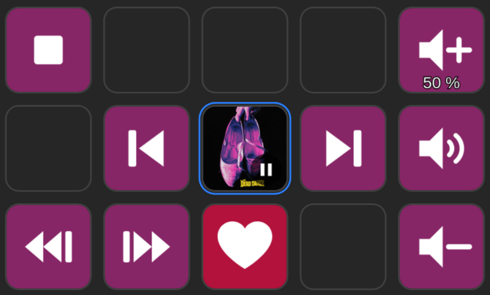

# QBZ Connector

Control [QBZ](https://github.com/vicrodh/qbz), the desktop Qobuz player for
Linux from a Stream Deck. QBZ Connector is a plugin for the
[OpenAction API](https://openaction.amankhanna.me/), so any OpenAction server can load it. It is developed and
tested against [OpenDeck](https://github.com/nekename/OpenDeck), the reference
server, which is what the instructions below assume.

Transport keys, seeking, cover art on the keys, Qobuz favourites, keys tinted
to match the album — and QBZ's in-app volume, the one inside the player, which
is not your system volume and which generic MPRIS plugins cannot drive
correctly on QBZ.



## Requirements

- Linux, and an OpenAction server. OpenDeck 7.0 or later is the tested one;
  others implementing the API should work but are unverified
- QBZ installed (`qbz`), signed in to your Qobuz account at least once
- Rust 1.80 or later: the plugin is built from source, there is no
  prebuilt download yet

## Install

### With OpenDeck

```bash
git clone https://github.com/biviale/streamdeck-qbzconnector.git
cd streamdeck-qbzconnector
./scripts/install.sh --restart
```

The script builds the plugin, copies it into
`~/.config/opendeck/plugins/com.biviale.qbzconnector.sdPlugin`, and restarts
OpenDeck. Leave out `--restart` if you would rather restart OpenDeck yourself;
it does have to restart, because it only reads a plugin's manifest at startup.

The actions show up in OpenDeck's action list, under **QBZ Connector**.
Drag one onto a key and it works straight away. Only favourites need a
one-time sign-in to Qobuz in order to work.

To update, pull and run the same command again. If an action changed shape
between two versions, **remove and re-add that action's keys**: a key keeps the
shape it was created with.

### Another OpenAction server

`install.sh` only knows OpenDeck's directory. Anywhere else, build the binary,
stage it inside the plugin directory, and copy that directory into wherever
your server keeps its plugins:

```bash
cargo build --release
install -m 755 target/release/qbzconnector com.biviale.qbzconnector.sdPlugin/
cp -r com.biviale.qbzconnector.sdPlugin /path/to/plugins/
```

It is the same plugin directory either way. The manifest declares Linux only,
since the plugin talks to QBZ over D-Bus.

## The keys

| Key | What it does |
|---|---|
| Play / Pause | Toggles playback. The icon follows QBZ's real state, not the press. Can show cover art. |
| Next / Previous track | Moves through the queue. |
| Stop | Stops playback. |
| Forward / Back | Seeks by a configurable amount, 10 s by default. |
| Volume + / − | Configurable step, linear or perceptual. Can show the current level. |
| Volume — fixed level | Jumps to an exact level, 30 % by default. |
| Mute | Mutes and unmutes. |
| Volume (dial) | Stream Deck+: turn for volume, press to mute. Never tested on hardware, see [Known limitations](#known-limitations). |
| Favourite | Adds or removes the current track from your Qobuz favourites. |
| Now playing | Cover art and the current title or artist. A display: pressing it does nothing. |

QBZ is treated as something that comes and goes: you can start the plugin
before QBZ, or quit QBZ in the middle of a session, and the keys pick up again
when it comes back. While it is closed, the Now playing key reads *QBZ offline* and the
volume keys show a dash instead of a level.

## Cover art on a key

Play / Pause and Now playing can show the album cover instead of their icon.
Tick **Cover art: show in background** in the key's settings, the property
inspector your server shows when you select a key.

On Play / Pause, a small play or pause badge is drawn in the corner, so the key
still tells you what it does and what QBZ is doing. When no cover is available,
because QBZ is closed or the track has no artwork, the key falls back to its
normal icon.

The option is off by default, so installing the plugin never changes the look
of keys you have already placed.

## Album colours

Tick **Colour: tint from the cover**, in the settings of any QBZ Connector key.
It is a global setting: ticked in one place, it applies everywhere, including to
keys that have no settings panel of their own.

With it on, the plugin draws the keys itself: the album's colour as the
background, a white symbol on top. The whole block of keys changes colour with
each album.

Two things worth knowing before you turn it on:

- While tinting is on, the plugin supplies the key images, so any custom image
  you set on a key is overridden. That is inherent, and it is why the
  setting is off by default.
- Covers are only downloaded when tinting or cover art is on.

Two keys keep their own colours. The heart stays crimson when the track is a
favourite and grey when there is nothing to favourite, because those colours
mean something an album must not overrule. The Stream Deck+ dial keeps the
colour from the manifest, its layout having no background the plugin can paint.

<details>
<summary>How the colour is chosen</summary>

The cover is scaled to 64×64 and each pixel is sorted into a hue bucket
weighted by its saturation, discarding blacks, whites and greys. The heaviest
bucket wins. This is deliberately the *vibrant* dominant rather than the
average: averaging a whole cover returns the same muddy brown for every album.
A cover with no usable colour, a monochrome sleeve for instance, falls back to a
neutral slate rather than being assigned an invented hue.

The symbols are white, so legibility has to be guaranteed rather than hoped
for: the chosen colour is forced into a dark band, its saturation capped, then
darkened until it clears 4.5:1 contrast against white (WCAG AA). A bright yellow
sleeve yields a deep ochre, not an unreadable key. A test sweeps all 360 hues at
five lightnesses to hold that promise.

</details>

## Volume

The volume keys drive QBZ's own volume, the slider inside the player. They do
not touch the system volume, so your other applications are unaffected. Tick
**Title: show the level** to read the current percentage on the key.

**Step and curve.** QBZ's volume is a linear amplitude: at a low level a
5-point step multiplies the volume more than sixfold, while at a high level it
is barely audible. Switch the curve to **Perceptual (dB)** and a step sounds the
same across the whole range. Worth choosing if you listen quietly.

**If the displayed level looks wrong.** The plugin keeps its own idea of the
volume, for reasons explained below, and one thing can make the two drift:
changing the volume with QBZ's own keyboard shortcuts. **Hold a volume key for
about a second** and it re-reads the level QBZ saved to disk. The fixed-level
key re-syncs too, since it writes an exact value.

<details>
<summary>Why the plugin has to track the volume itself</summary>

QBZ publishes an MPRIS `Volume` property, but it is only usable for writing.
The setter works and really does drive the audio engine; the getter answers the
`1.0` it was initialised with forever, because QBZ never feeds the level back
into its MPRIS state. Observed live: `busctl` reported `1.0` while the real
level was `0.009`. A plugin that trusts the property therefore shows the wrong
number and, worse, computes the wrong target on a relative step.

So the plugin keeps its own value and re-anchors it to the truth at every
opportunity:

1. **Seed** — read `~/.local/share/qbz/ui_prefs.json`, the level QBZ restores at
   startup.
2. **Adopt** — watch that file. QBZ writes it when you release its volume
   slider, which is the main way the value could drift.
3. **Own** — every write the plugin makes is absolute, so it is exact.

The upstream fix would be a few lines in QBZ's
`crates/qbz-qt/src/media_controls_qt.rs`, calling `mc.set_volume(...)` on every
change. It would be worth an issue at
[vicrodh/qbz](https://github.com/vicrodh/qbz).

</details>

## Qobuz favourites

The Favourite key adds or removes the current track from your Qobuz favourites,
and shows whether it is already one.

**Signing in.** Select the key, open its settings and click **Sign in to
Qobuz**; your browser opens on the Qobuz page. The plugin opens its own
Qobuz session rather than borrowing QBZ's, which is encrypted with a key derived
from QBZ's own salt.

Your `user_auth_token` is kept in the **system keyring** through
`org.freedesktop.secrets` (KWallet on KDE, GNOME Keyring on GNOME), unlocked
when you log in. The settings your server stores hold only your display name
and account id.

> **Fallback without a keyring.** If no Secret Service provider is available,
> the token is written to `~/.config/qbzconnector/token`, scrambled with a
> random pad stored beside it at `0600`. That is **obfuscation, not
> protection**: it keeps a plain-text token out of a backup, and nothing more.
> Anything running as you can read it.

The plugin reads the Qobuz application credentials (`app_id`, signing secrets)
from QBZ's cache at `~/.cache/qbz/bundle_tokens.json`, rather than extracting
them from Qobuz's web bundle itself: that extraction is the most
breakage-prone piece of code in the ecosystem, QBZ already maintains it, and
this plugin is useless without QBZ anyway. If the file is missing, open QBZ and
sign in once.

## Known limitations

Most of these are missing because QBZ does not expose them, not by oversight:

- **Shuffle and repeat** are hardcoded on QBZ's MPRIS side (`Shuffle` always
  returns `false`, `LoopStatus` always `None`) and their setters do nothing, so
  there are no keys for them.
- **Mute is simulated.** QBZ's internal mute is not on the bus, so the Mute key
  writes 0 and remembers the previous level.
- **Reading the volume back** is not possible, see above.
- **Favourites are not on QBZ's D-Bus interface**, which exposes only `Present`
  and `OpenUrl`, hence the separate Qobuz session.
- **Stream Deck+ dial support has never run on hardware.** The rotation, press
  and tap handling is implemented, but it was developed on a 15-key Stream Deck
  MK.2, which has no dial. Treat it as unverified; reports welcome.

## Troubleshooting

**The keys do nothing, or look inactive.** Check that QBZ is running. The
plugin follows QBZ starting and stopping, so nothing needs restarting once it
comes back.

**The level on the key does not match QBZ.** Hold a volume key for about a
second to re-read the saved level, see [Volume](#volume).

**The Favourite key stays greyed out.** Either no track is playing, or you are
not signed in, or `~/.cache/qbz/bundle_tokens.json` does not exist yet, which is
fixed by opening QBZ and signing in once.

**Nothing appeared in the action list after installing.** A server reads
plugin manifests at startup only; restart it. If the actions are there but
misbehave after an update, remove and re-add their keys.

**Reading the log.** OpenDeck keeps it here; another server will have its own
location.

```bash
tail -f ~/.local/share/opendeck/logs/plugins/com.biviale.qbzconnector.sdPlugin.log
```

## Development

```bash
./scripts/test.sh          # formatting, lints and unit tests
./scripts/test.sh --live   # plus the tests that need QBZ and a keyring running
cargo build --release
```

Tests live beside the code they cover, in `#[cfg(test)]` modules; every test
name describes a defect that actually happened. The ones marked `#[ignore]` need
a live environment, and those in `src/volume.rs` move the real volume, which is
why they are behind `--live`.

`src/hub.rs` holds the single D-Bus connection and publishes a state snapshot
that every action observes. `src/volume.rs` carries the shadow volume level,
`src/palette.rs` extracts the album colour and guarantees its contrast,
`src/glyphs.rs` paints tinted keys, `src/qobuz/` holds the minimum of the Qobuz
API needed, `src/actions/` has one module per family of keys, and
`src/settings.rs` merges the global settings so the Qobuz identity and the
appearance toggle cannot overwrite each other.

Icons are generated rather than hand-drawn: `python3 scripts/make_icons.py`
writes both the manifest tiles (`icons/`) and the white masks embedded in the
binary (`assets/glyphs/`) from the same shapes, so the two cannot drift. It
needs `rsvg-convert`.

This plugin was written with Claude Code, which is also what `CLAUDE.md` is there for:
it records the traps worth knowing before changing any of this.

## Licence

MIT. Parts of `src/qobuz/` (request signing, the OAuth flow) derive from QBZ,
also MIT, see `LICENSES/qbz-MIT.txt`.

QBZ Connector is an unofficial plugin. It is not affiliated with Qobuz, nor
with the QBZ, OpenAction or OpenDeck projects.
